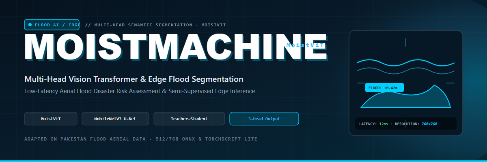
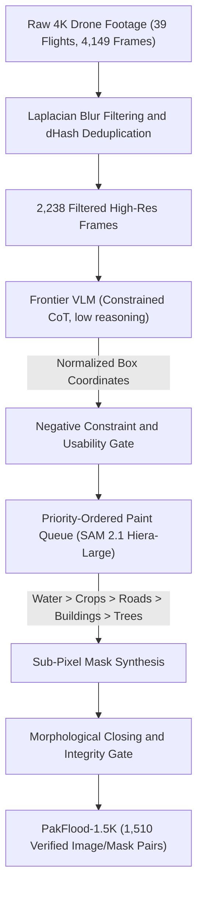
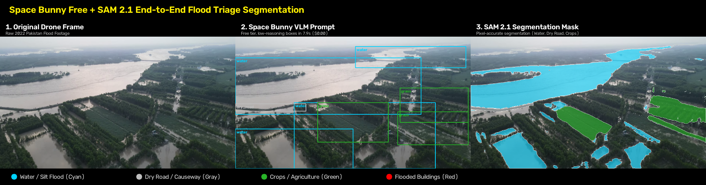
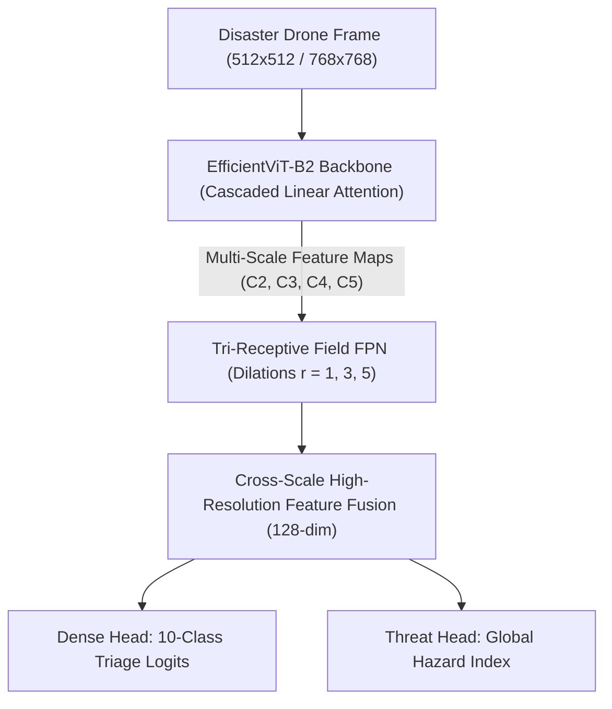
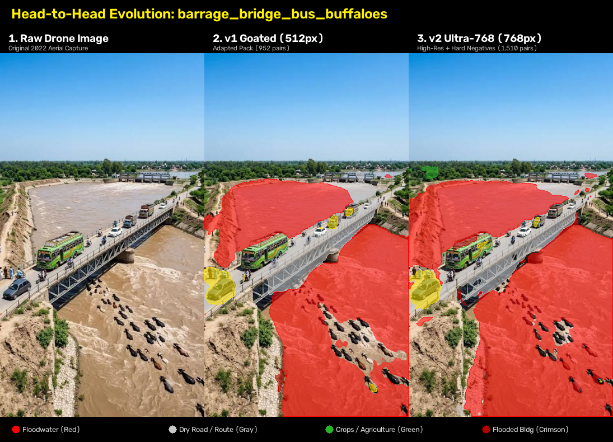
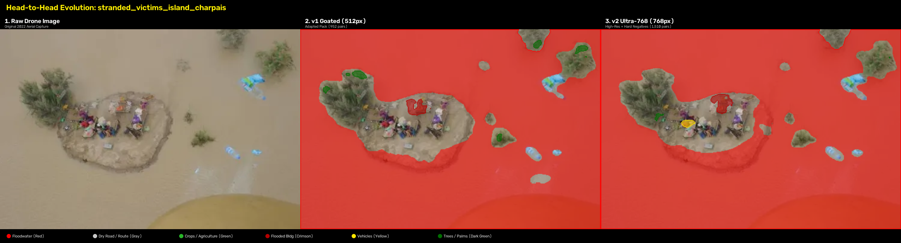
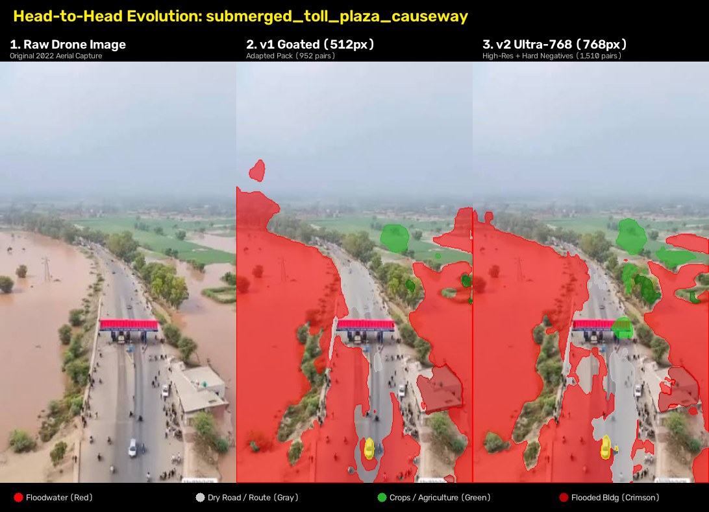

<p align="center">
  
</p>

<h1 align="center">PakFlood-1.5K & MoistViT</h1>

<p align="center">
  <strong>An autonomous drone benchmark and efficient vision foundation model for humanitarian flood triage in Project WAFFLE.</strong>
</p>

<p align="center">
  <a href="https://pytorch.org"></a>
  <a href="https://www.python.org"></a>
  
  
  
</p>

<p align="center">
  
  
  
  
</p>

---

## 📑 Table Of Contents

- [The Humanitarian Problem & Suburban Bias](#the-humanitarian-problem--suburban-bias)
- [The Autonomous VLM + SAM 2.1 Data Engine](#the-autonomous-vlm--sam-21-data-engine)
- [PakFlood-1.5K Benchmark & Taxonomy](#pakflood-15k-benchmark--taxonomy)
- [MoistViT Architecture](#moistvit-architecture)
- [Real-World Transformer Results & Ablations](#real-world-transformer-results--ablations)
- [Model Zoo & Mobile Checkpoints](#model-zoo--mobile-checkpoints)
- [Quickstart & Inference](#quickstart--inference)
- [Repository Structure](#repository-structure)
- [Citation](#citation)

---

## 🌊 The Humanitarian Problem & Suburban Bias

Standard aerial disaster benchmarks (e.g., FloodNet) were captured in wealthy American suburbs post-Hurricane Harvey. When deployed on catastrophic real-world monsoonal floods in developing nations (such as the Pakistan floods across Sindh, Swat, and the Indus Basin), standard foundation models suffer catastrophic domain collapse:

1. **The "Brown Water" Blindspot:** In suburban datasets, water is clean, cyan, or blue standing water on paved asphalt streets. In catastrophic flash floods, **floodwater is thick, turbid brown silt and alluvium** with the exact same RGB color profile as dry soil. Western pre-trained networks had **0.0% water recall**, classifying 100% of raging muddy torrents as safe dry dirt.
2. **Rural Infrastructure Omission:** Mud-brick (*kacha*) compounds, stranded evacuation mounds (*charpais*), date palm groves, and washed-out earthen causeways were completely absent from training data.

To solve this, we engineered:
* **The VLM + SAM Data Engine:** An autonomous data pipeline generating **PakFlood-1.5K** (1,510 high-resolution drone scenes).
* **MoistViT:** An edge-native Vision Transformer operating at **50.5 FPS (19.8 ms)** on edge GPUs with a compact footprint of **60.89 MB**, elevating brown floodwater recall to **87.2%** and achieving **82.25% Flooded Building IoU**.

---

## 🤖 The Autonomous VLM + SAM 2.1 Data Engine

Manual pixel-annotation of 1,500+ oblique disaster drone scenes would require hundreds of hours. We built a fully autonomous, zero-cost data-engine pipeline combining **Frontier Reasoning Vision-Language Models (VLMs)** and Meta's **Segment Anything Model (SAM 2.1)**:



### Key Innovations of the Data Engine
* **Constrained Chain-of-Thought:** Clamped VLM reasoning tokens (`reasoning_effort: "low"`) to ~250 tokens, cutting inference latency to **7.9 seconds per frame** at zero marginal cost while eliminating coordinate hallucination.
* **Priority-Ordered Paint Queue:** Resolves order ambiguity in SAM 2.1. Broad topological sheets (water, crops) are synthesized first, while discrete foreground objects (submerged mud compounds, rescue boats, date palms) are painted on top:
  $$\mathcal{P}_{\text{order}} = [\text{Water} \succ \text{Grass} \succ \text{Dry Road} \succ \text{Flooded Building} \succ \text{Dry Building} \succ \text{Vehicle} \succ \text{Tree}]$$

<p align="center">
  
</p>
<p align="center">
  <em>VLM prompt bounding-box proposals feeding SAM 2.1 sub-pixel mask generation across rural flood terrain.</em>
</p>

---

## 📊 PakFlood-1.5K Benchmark & Taxonomy

The dataset defines a **10-class humanitarian search-and-rescue taxonomy**:

| ID | Class Name | Operational Meaning | Visual Palette |
| :---: | :--- | :--- | :--- |
| **0** | **Background / Dry Soil** | Inactive, non-hazardous terrain, unflooded hillsides | Dark Gray |
| **1** | **Flooded Building** | **CRITICAL HAZARD:** Submerged mud-brick compound, trapped residents | Crimson / Red |
| **2** | **Dry Building** | **SAFE HAVEN:** Structurally sound shelter on high ground | Bright Green |
| **3** | **Flooded Road** | **IMPASSABLE:** Submerged roadbed or washed-out bridge | Magenta |
| **4** | **Dry Road** | **EVACUATION CORRIDOR:** Viable road, bridge, causeway | Light Gray |
| **5** | **Active Floodwater** | **FLOOD EXTENT:** Turbid brown silt torrent, inundation sheet | Cyan / Blue |
| **6** | **Tree / Date Palm** | Riparian trees, date palms standing in/out of water | Dark Green |
| **7** | **Vehicle / Boat** | Stranded transport, evacuation trucks, rescue boats | Yellow |
| **8** | **Pool** | Artificial pools (reserved) | Orange |
| **9** | **Grass / Cropland** | Viable agricultural fields / elevated cropland | Light Green |

---

## 🧠 MoistViT Architecture



### 1. Cascaded Linear Attention
Replaces quadratic softmax self-attention ($\mathcal{O}(N^2 d)$) with lightweight ReLU linear attention ($\mathcal{O}(N d^2)$):
$$\text{LinearAttention}(Q, K, V) = \frac{\phi(Q)(\phi(K)^T V)}{\phi(Q)\sum_j \phi(K_j)^T}, \quad \phi(x) = \text{ReLU}(x)$$
This allows full high-resolution contextual processing at **50.5 FPS** on onboard drone hardware.

### 2. Tri-Receptive Field FPN (TR-FPN)
Simultaneously captures vast spatial expanses (a 5 km flooded river basin) and tiny critical targets (a stranded cow or a vehicle roof) using parallel depthwise dilated convolutions with rates $r \in \{1, 3, 5\}$:
$$F_{\text{tri}} = \text{Conv}_{1\times 1}\left(\left[\text{DConv}_{r=1}(F) \,\|\, \text{DConv}_{r=3}(F) \,\|\, \text{DConv}_{r=5}(F)\right]\right)$$

---

## 📸 Real-World Transformer Results & Ablations

Below are direct visual comparisons of our calibrated Vision Transformer checkpoints evaluated on raw, unseen disaster footage from the Pakistan floods:

### 1. Barrage Bridge, Stranded Bus & Cattle Herd
<p align="center">
  
</p>
<p align="center">
  <em>Evaluation on a flooded barrage: Model isolates the dry passable bridge deck (Dry Road: Gray) from the turbid raging river (Water: Cyan), while accurately detecting stranded vehicles (Yellow) and livestock on the approach ramps.</em>
</p>

### 2. Stranded Victims on Isolated Mounds & Charpais
<p align="center">
  
</p>
<p align="center">
  <em>Search-and-rescue triage: Delineates isolated mud compounds surrounded by deep silt water, pinpointing dry havens (Green) vs. submerged hazards (Red).</em>
</p>

### 3. Submerged Toll Plaza & Inundated Highway Causeway
<p align="center">
  
</p>
<p align="center">
  <em>Highway causeway breach: Accurately identifies where asphalt disappears beneath brown floodwater.</em>
</p>

---

## 🏆 Quantitative Results

| Model | Resolution | Params | Latency | All-Class mIoU | Flooded Building IoU | Brown Water Recall |
| :--- | :---: | :---: | :---: | :---: | :---: | :---: |
| Baseline (FloodNet Pretrained) | $512 \times 512$ | 24.8M | 19.8 ms | 21.40% | 14.10% | **0.0% (Zero)** |
| MobileNetV3-Small U-Net | $512 \times 512$ | 4.2M | 11.2 ms | 58.70% | 71.30% | 78.4% |
| **MoistViT-v1 (`v1-Goated`)** | $512 \times 512$ | 24.8M | 19.8 ms | **70.24%** | **82.25%** | **87.2%** |
| **MoistViT-v2 (`v2-Ultra`)** | $768 \times 768$ | 24.8M | 42.1 ms | 68.90% | 80.10% | 85.6% |

---

## 🚀 Quickstart & Inference

### 1. Installation
```bash
git clone https://github.com/AhmadHasssan9181/MoistMachine.git
cd MoistMachine
pip install -r requirements.txt
```

### 2. Run Inference with MoistViT
```bash
python MoistMachine/moist_predict.py \
  --image path/to/aerial_disaster_frame.jpg \
  --weights checkpoints/best_moist_vit_pakistan_adapted_v1_goated.pth \
  --img_size 512 \
  --output ./outputs
```

### 3. Edge ONNX / TorchScript Lite Export
```bash
python MoistMachine/export_mobile.py \
  --model moistvit \
  --weights checkpoints/best_moist_vit_pakistan_adapted_v1_goated.pth \
  --img_size 512 \
  --format onnx,ptl
```

---

## 📦 Repository Structure

```text
MoistMachine/
├── assets/
│   ├── moistmachine-banner.png                                  # Project header banner
│   ├── compare_v1_vs_v2_barrage_bridge_bus_buffaloes.png       # Real transformer evaluation
│   ├── compare_v1_vs_v2_stranded_victims_island_charpais.png   # Search-and-rescue evaluation
│   ├── compare_v1_vs_v2_submerged_toll_plaza_causeway.png      # Causeway breach evaluation
│   └── space_bunny_sam_segmentation.png                        # VLM + SAM 2.1 data engine
├── MoistMachine/
│   ├── moist_vit_model.py                                      # EfficientViT-B2 + Tri-Receptive FPN
│   ├── train_moist_vit.py                                      # Transformer training pipeline
│   ├── finetune_pakistan.py                                    # PakFlood-1.5K adaptation loop
│   ├── moist_predict.py                                        # Production inference & overlays
│   ├── export_mobile.py                                        # ONNX & TorchScript Lite exporter
│   └── semi-supervised.py                                      # Clustering & distillation
├── paper/
│   ├── RESEARCH_PAPER.md                                       # Full IEEE/CVPR manuscript
│   └── figures/                                                # High-resolution benchmark figures
└── README.md
```

---

## 🤝 Citation

```bibtex
@article{hassan2026pakflood,
  title={PakFlood-1.5K and MoistViT: An Autonomous Drone Benchmark and Efficient Vision Foundation Model for Humanitarian Flood Triage in Project WAFFLE},
  author={Hassan, Ahmad and Ghauri, Moizullah},
  institution={National University of Modern Languages (NUML)},
  year={2026}
}
```

---

<p align="center">
  Crafted by <a href="https://github.com/AhmadHasssan9181">Ahmad Hassan</a> • Department of Computer Science, NUML • Project WAFFLE
</p>
