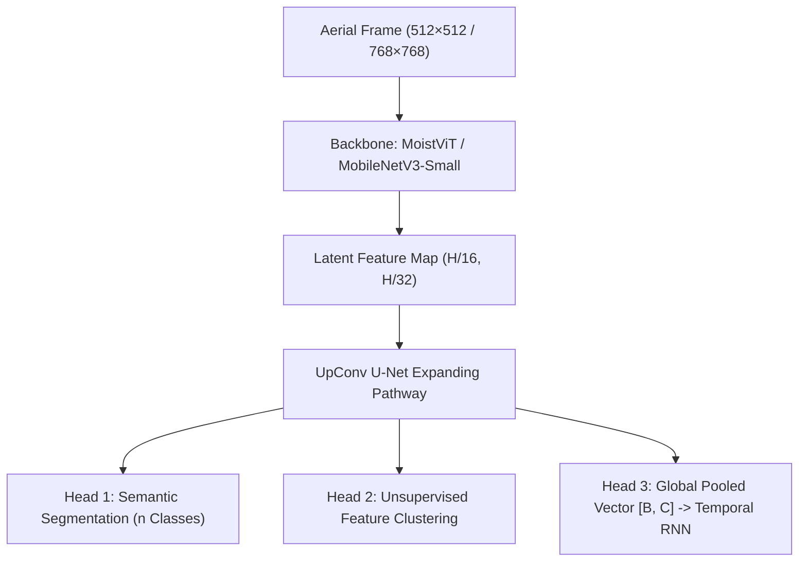

<p align="center">
  
</p>

<h1 align="center">🌊 MoistMachine & MoistViT</h1>

<p align="center">
  <strong>Multi-head semantic segmentation, Vision Transformers, and semi-supervised pipelines for aerial flood disaster response on edge hardware.</strong>
</p>

<p align="center">
  <a href="https://pytorch.org"></a>
  <a href="https://www.python.org"></a>
  
  
  
</p>

<p align="center">
  
  
  
  
</p>

---

## ⚡ Overview

Floods represent one of the most destructive natural disasters, yet the communities hit hardest rarely have cloud connectivity or workstation-class GPUs. Real-time flood extent mapping, building damage assessment, and navigable road extraction must run directly on battery-constrained drones or low-power embedded companion computers.

**MoistMachine** is an edge-first flood segmentation framework built to bridge heavy vision research and real-world deployment:
* **MoistViT:** Lightweight vision transformer designed for high-resolution contextual reasoning ($512 \times 512$ and $768 \times 768$).
* **Multi-Head Architecture:** Concurrently outputs standard semantic masks, per-pixel unsupervised feature clusters, and global pooled state vectors for temporal video modeling.
* **Semi-Supervised & Distillation:** Employs teacher-student knowledge distillation from heavy foundational backbones (SegFormer and ResNet) down to sub-10 MB edge student models.
* **Pakistan Flood Adaptation:** Fine-tuned on real-world aerial imagery from the severe Pakistan flood events, achieving robust generalization over muddy floodwaters, rural terrain, and submerged infrastructure.
* **Deployment-Ready:** Full ONNX and TorchScript Lite (`.ptl`) mobile export pipelines.

---

## 🧠 Model Architecture & Multi-Head Design



### The Three Output Heads
1. **Semantic Head (`seg_head`):** $1 \times 1$ convolution generating dense pixel logits across flood classes (Flooded Buildings, Non-flooded Buildings, Flooded Roads, Standing Water, Debris, Vehicles).
2. **Unsupervised Clustering Head (`cluster_head`):** Generates low-dimensional per-pixel representations mapped into $K$ feature clusters. This allows the model to learn structure from massive unlabeled aerial video without manual annotation.
3. **Global Pooled Vector (`pooled`):** Computes spatial global-average pooled softmax activations, yielding a compressed scene-level representation fed directly into GRU/LSTM networks for temporal change-detection across video streams.

---

## 📊 Available Implementations

| Pipeline | Script | Description |
| :--- | :--- | :--- |
| **MoistViT (Transformer)** | `MoistMachine/moist_vit_model.py` | Vision Transformer architecture tuned for high spatial fidelity. |
| **MobileNetV3 Multi-Head** | `MoistMachine/model_multihead_mbv3.py` | Ultra-fast edge CNN running with ~12ms latency on mobile CPUs. |
| **Teacher-Student Distill** | `MoistMachine/semi-supervised.py` | Knowledge distillation pipeline transferring SegFormer/ResNet features. |
| **Temporal Sequence Model** | `MoistMachine/train_seq.py` | GRU-based sequence network tracking water level rise over time. |
| **Mobile Export Engine** | `MoistMachine/export_mobile.py` | Exports PyTorch checkpoints to ONNX and TorchScript Lite (`.ptl`). |

---

## 🚀 Quickstart

### 1. Installation
```bash
git clone https://github.com/AhmadHasssan9181/MoistMachine.git
cd MoistMachine
pip install -r requirements.txt
```

### 2. Run Inference
Generate flood segmentation predictions on test aerial frames:
```bash
python MoistMachine/inference.py --image path/to/flood_aerial.jpg --model mbv3 --weights checkpoints/best_moist_model.pth
```

### 3. Train MoistViT
```bash
python MoistMachine/train_moist_vit.py --data_dir /path/to/flood_dataset --img_size 512 --batch_size 8 --epochs 100
```

### 4. Export to Edge (ONNX / TorchScript Lite)
```bash
python MoistMachine/export_mobile.py --weights checkpoints/best_moist_vit.pth --output ./exports --format onnx,ptl
```

---

## 📦 Repository Structure

```
MoistMachine/
├── assets/
│   ├── moistmachine-banner.png       # High-resolution project banner
│   └── moistmachine-banner.svg       # Vector banner graphic
├── MoistMachine/
│   ├── moist_vit_model.py            # MoistViT Vision Transformer definition
│   ├── model_multihead_mbv3.py       # MobileNetV3 multi-head edge network
│   ├── model_multihead.py            # MobileNetV2 base multi-head network
│   ├── semi-supervised.py            # Semi-supervised clustering & pseudo-labeling
│   ├── train_moist_vit.py            # Vision Transformer training pipeline
│   ├── train_seg.py                  # Semantic head training loop
│   ├── train_seq.py                  # Temporal video sequence tracking
│   ├── export_mobile.py              # ONNX & TorchScript Lite (.ptl) exporter
│   └── inference.py                  # Batch & single image inference
├── teacher_res/                      # High-capacity teacher models (ResNet/SegFormer)
└── README.md
```

---

<p align="center">
  Crafted by <a href="https://github.com/AhmadHasssan9181">Ahmad Hassan</a> • Designed for Drone Autonomy & Disaster Intelligence
</p>
